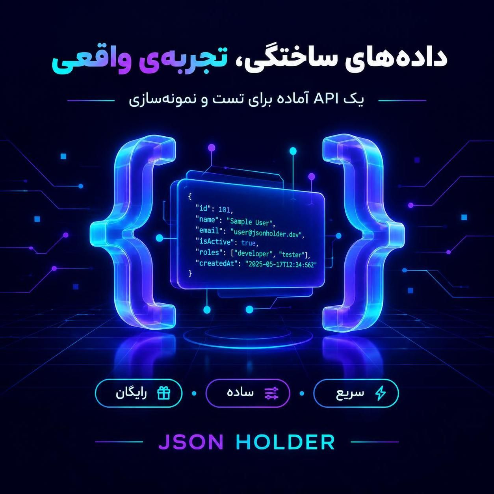

# Persian JSON Placeholder

A free REST API providing Persian sample data for Front-end, Mobile, and Backend developers.

[Website](<https://jsonholder.ir/>) · [API](<https://jsonholder.ir/api/v1>) · [GitHub Repository](<https://github.com/4xmen/persian-json-placeholder>)

## What is Persian JSON Placeholder?

One of the common needs in web and mobile application development is access to sample data for implementing and testing different parts of an application.

Whether you're building a user interface, implementing API integration, or creating a prototype, having a backend service with realistic sample data can make the development process much easier. Setting up and maintaining such a service is not always necessary or practical, especially during the early stages of development.

Persian JSON Placeholder was created to address this need.

It is a REST API service (Fake API) that provides a collection of Persian sample data, allowing developers to send HTTP requests and receive JSON responses without having to implement their own backend.

The service is suitable for:

- Practicing and learning how REST APIs work.
- Developing and testing Front-end applications.
- Developing mobile applications.
- Building prototypes and proof-of-concept applications.
- Testing Client-Server communication.
- Learning CRUD operations and working with JSON data.

### Features

- Persian sample data suitable for Persian-language applications.
- RESTful API structure.
- GET request support.
- No authentication required.
- Access to both collection and individual resources.
- Sample resources including users, products, categories, posts, and todos.
- Open-source and extensible.



## Why Rustavel?

The project was originally developed using Laravel.

With the beginning of [Rustavel](<https://github.com/4xmen/rustavel>), we decided to rewrite Persian JSON Placeholder using this framework as its first experimental project.

However, the purpose of this rewrite was not simply to switch programming languages or replace Laravel with Rust.

Rustavel is a Rust-based backend development framework inspired by the developer experience of Laravel, while aiming to embrace the principles and constraints of the Rust ecosystem.

Evaluating a system like this requires more than writing small examples or testing isolated components. We need a real-world project that brings different parts of the system together and puts them into practical use.

Persian JSON Placeholder provides exactly that opportunity.

### Goals of the Rewrite

- Real-world testing: Using Rustavel in a practical application rather than limiting its usage to isolated experiments.
- Architecture evaluation: Evaluating how different parts of the system interact within a real application.
- Identifying limitations: Discovering issues and missing features that become apparent during practical development.
- Developer experience: Evaluating the simplicity and efficiency of Rustavel's development tools and workflows.
- Reliability testing: Assessing the system through real-world scenarios and identifying areas that need improvement.
- Contributing to Rustavel: Using the experience and findings to help guide the development and prioritization of future features.

In other words, this project is part of the Rustavel development and evaluation process, rather than simply another application built with it.

The experience gained from developing and maintaining this project can help inform architectural decisions and future development priorities for Rustavel.

For more information about the development direction of Rustavel, please refer to its [Roadmap](<https://github.com/4xmen/rustavel/blob/master/docs/ROADMAP.md>).

> Persian JSON Placeholder is the first real-world project selected to evaluate Rustavel's capabilities. Our goal is to assess the framework in practical use and contribute to its ongoing development.

## Getting Started

Using this service is straightforward. Simply send an HTTP request to the API endpoint and receive a JSON response.

Base API URL:

text

```text
https://jsonholder.ir/api/v1
```

### Using JavaScript (Fetch)

javascript

```javascript
fetch("https://jsonholder.ir/api/v1/users")
    .then(response => response.json())
    .then(data => {
        console.log(data);
    })
    .catch(error => console.error(error));
```

### Using Axios

javascript

```javascript
axios
    .get("https://jsonholder.ir/api/v1/users")
    .then(response => {
        console.log(response.data);
    })
    .catch(error => {
        console.error(error);
    });
```

### Using jQuery

javascript

```javascript
$.get("https://jsonholder.ir/api/v1/users", function (data) {
    console.log(data);
});
```

### Using cURL

bash

```bash
curl https://jsonholder.ir/api/v1/users
```

## API Endpoints

All endpoints support the GET method.

| Resource | Endpoint |
| --- | --- |
| Users | `/users` |
| Single User | `/users/{id}` |
| Todos | `/todos` |
| Categories | `/categories` |
| Single Category | `/categories/{slug}` |
| Products | `/products` |
| Single Product | `/products/{slug}` |
| Posts | `/posts` |
| Single Post | `/posts/{slug}` |

### Request Examples

Get all users

http

```http
GET https://jsonholder.ir/api/v1/users
```

Get a specific user

http

```http
GET https://jsonholder.ir/api/v1/users/1
```

Get all products

http

```http
GET https://jsonholder.ir/api/v1/products
```

Get a specific product

http

```http
GET https://jsonholder.ir/api/v1/products/mobile-phone-example
```

Get all posts

http

```http
GET https://jsonholder.ir/api/v1/posts
```

Get a specific post

http

```http
GET https://jsonholder.ir/api/v1/posts/example-post
```

For the complete API documentation and available resources, visit the [official website](<https://jsonholder.ir/>).

## Contributing

This project is open-source, and contributions from developers are welcome.

If you have suggestions for improving the sample data, API endpoints, or existing features, feel free to open an Issue or submit a Pull Request.

If you're also interested in Rustavel, contributing to this project can be a great opportunity to explore its practical capabilities.

## Related Projects

- [Rustavel](<https://github.com/4xmen/rustavel>) – A Rust-based backend development framework.
- [Original Laravel Version](<https://github.com/A1Gard/persian-json-placeholder/tree/laravel>) – The original implementation of Persian JSON Placeholder.
- [Persian JSON Placeholder Website](<https://jsonholder.ir/>)

## License

This project is released under the MIT License. See the LICENSE file for more information.


# Persian JSON Placeholder

یک REST API آزمایشی و رایگان با داده‌های پارسی برای توسعه‌دهندگان Front-end، Mobile و Backend.

[وب‌سایت پروژه](<https://jsonholder.ir/>) · [مشاهده API](<https://jsonholder.ir/api/v1>) · [مخزن GitHub](<https://github.com/4xmen/persian-json-placeholder>)

## پروژه چیست؟

یکی از نیازهای رایج هنگام توسعه اپلیکیشن‌های وب و موبایل، دسترسی به داده‌های آزمایشی برای پیاده‌سازی و تست بخش‌های مختلف برنامه است.

معمولاً برای تست یک رابط کاربری، پیاده‌سازی ارتباط با API یا ساخت یک Prototype، به یک سرویس Backend و مجموعه‌ای از داده‌های واقعی‌نما نیاز داریم. راه‌اندازی چنین سرویسی برای پروژه‌های کوچک یا مراحل اولیه توسعه همیشه ضروری یا مقرون‌به‌صرفه نیست.

Persian JSON Placeholder با همین هدف ایجاد شده است.

این پروژه یک سرویس REST API آزمایشی (Fake API) است که مجموعه‌ای از داده‌های پارسی را در اختیار توسعه‌دهندگان قرار می‌دهد تا بدون نیاز به پیاده‌سازی Backend اختصاصی، بتوانند درخواست‌های HTTP ارسال کنند و پاسخ‌های JSON دریافت کنند.

این سرویس برای موارد زیر مناسب است:

- تمرین و یادگیری نحوه کار با REST API
- توسعه و تست اپلیکیشن‌های Front-end
- توسعه اپلیکیشن‌های موبایل
- ساخت Prototype و نمونه‌های اولیه
- تست ارتباط بین Client و Server
- آموزش مفاهیم CRUD و کار با داده‌های JSON

### امکانات

- داده‌های پارسی و متناسب با محتوای فارسی
- ساختار RESTful API
- دریافت اطلاعات با متد GET
- بدون نیاز به احراز هویت
- دسترسی به اطلاعات به‌صورت لیست و تکی
- پشتیبانی از کاربران، محصولات، دسته‌بندی‌ها، نوشته‌ها و تسک‌ها
- متن‌باز و قابل توسعه


## چرا Rustavel؟

این پروژه در ابتدا با استفاده از Laravel توسعه داده شده بود.

با شروع توسعه [Rustavel](<https://github.com/4xmen/rustavel>)، تصمیم گرفتیم Persian JSON Placeholder را به‌عنوان اولین پروژه آزمایشی روی این ابزار بازنویسی کنیم.

اما هدف از این بازنویسی صرفاً تغییر زبان برنامه‌نویسی یا جایگزین کردن Laravel با Rust نبود.

Rustavel یک ابزار توسعه Backend مبتنی بر Rust است که با الهام از تجربه توسعه‌دهنده در Laravel طراحی شده، اما تلاش می‌کند اصول و محدودیت‌های اکوسیستم Rust را حفظ کند.

برای اینکه بتوانیم قابلیت‌های چنین سیستمی را ارزیابی کنیم، صرفاً نوشتن مثال‌های کوچک یا تست کردن اجزای مستقل کافی نیست. به یک پروژه واقعی نیاز داریم که بتواند بخش‌های مختلف سیستم را در کنار یکدیگر به کار بگیرد.

Persian JSON Placeholder این فرصت را فراهم می‌کند.

### اهداف این بازنویسی

- آزمایش در شرایط واقعی: استفاده از Rustavel در یک پروژه کاربردی به‌جای محدود شدن به مثال‌های آزمایشگاهی.
- ارزیابی معماری: بررسی نحوه تعامل بخش‌های مختلف سیستم در یک اپلیکیشن واقعی.
- شناسایی محدودیت‌ها: پیدا کردن مشکلات و کمبودهایی که در استفاده عملی از ابزار مشخص می‌شوند.
- ارزیابی تجربه توسعه‌دهنده: بررسی میزان سادگی و کارایی ابزارهای توسعه Rustavel.
- تست قابلیت اطمینان: بررسی عملکرد سیستم در سناریوهای واقعی و شناسایی نقاط نیازمند بهبود.
- کمک به توسعه Rustavel: انتقال تجربه‌ها و مشکلات به مسیر توسعه و Roadmap پروژه اصلی.

در واقع این پروژه بخشی از فرآیند توسعه Rustavel است؛ نه صرفاً یک پروژه جانبی که با آن ساخته شده باشد.

نتایج و تجربه‌های حاصل از توسعه و نگهداری این پروژه می‌توانند در تصمیم‌گیری‌های معماری و اولویت‌بندی قابلیت‌های آینده Rustavel مؤثر باشند.

برای مشاهده جزئیات مسیر توسعه Rustavel می‌توانید [Roadmap پروژه](<https://github.com/4xmen/rustavel/blob/master/docs/ROADMAP.md>) را مطالعه کنید.

> Persian JSON Placeholder اولین پروژه واقعی انتخاب‌شده برای ارزیابی قابلیت‌های Rustavel است. هدف ما بررسی عملکرد یک سیستم در استفاده عملی و کمک به تکامل آن است.

## روش استفاده از سرویس

استفاده از این سرویس بسیار ساده است. کافی است درخواست HTTP به آدرس API ارسال کنید و پاسخ JSON را دریافت نمایید.

آدرس اصلی API:

text

```text
https://jsonholder.ir/api/v1
```

### استفاده از JavaScript (Fetch)

javascript

```javascript
fetch("https://jsonholder.ir/api/v1/users")
    .then(response => response.json())
    .then(data => {
        console.log(data);
    })
    .catch(error => console.error(error));
```

### استفاده از Axios

javascript

```javascript
axios
    .get("https://jsonholder.ir/api/v1/users")
    .then(response => {
        console.log(response.data);
    })
    .catch(error => {
        console.error(error);
    });
```

### استفاده از jQuery

javascript

```javascript
$.get("https://jsonholder.ir/api/v1/users", function (data) {
    console.log(data);
});
```

### استفاده از cURL

bash

```bash
curl https://jsonholder.ir/api/v1/users
```

## لیست API ها

تمام آدرس‌ها از متد GET پشتیبانی می‌کنند.

| عنوان | آدرس |
| --- | --- |
| کاربران | `/users` |
| کاربر مشخص | `/users/{id}` |
| تسک‌ها | `/todos` |
| دسته‌بندی‌ها | `/categories` |
| دسته‌بندی مشخص | `/categories/{slug}` |
| محصولات | `/products` |
| محصول مشخص | `/products/{slug}` |
| نوشته‌ها | `/posts` |
| نوشته مشخص | `/posts/{slug}` |

### مثال درخواست‌ها

دریافت لیست کاربران

http

```http
GET https://jsonholder.ir/api/v1/users
```

دریافت یک کاربر مشخص

http

```http
GET https://jsonholder.ir/api/v1/users/1
```

دریافت لیست محصولات

http

```http
GET https://jsonholder.ir/api/v1/products
```

دریافت یک محصول مشخص

http

```http
GET https://jsonholder.ir/api/v1/products/mobile-phone-example
```

دریافت لیست نوشته‌ها

http

```http
GET https://jsonholder.ir/api/v1/posts
```

دریافت یک نوشته مشخص

http

```http
GET https://jsonholder.ir/api/v1/posts/example-post
```

برای مشاهده اطلاعات و لیست کامل APIها می‌توانید به [وب‌سایت پروژه](<https://jsonholder.ir/>) مراجعه کنید.

## مشارکت در پروژه

این پروژه متن‌باز است و از مشارکت توسعه‌دهندگان استقبال می‌کنیم.

اگر پیشنهادی برای بهبود داده‌ها، APIها یا قابلیت‌های پروژه دارید، می‌توانید Issue ثبت کنید یا Pull Request ارسال نمایید.

همچنین اگر به توسعه Rustavel علاقه‌مند هستید، مشارکت در این پروژه می‌تواند فرصت مناسبی برای بررسی کاربرد عملی آن باشد.

## پروژه‌های مرتبط

- [Rustavel](<https://github.com/4xmen/rustavel>) – ابزار توسعه Backend مبتنی بر Rust
- [نسخه اولیه Laravel](<https://github.com/A1Gard/persian-json-placeholder/tree/laravel>) – پیاده‌سازی اولیه Persian JSON Placeholder
- [وب‌سایت Persian JSON Placeholder](<https://jsonholder.ir/>)

## License

این پروژه تحت مجوز MIT منتشر شده است. برای اطلاعات بیشتر فایل LICENSE را مطالعه کنید.
